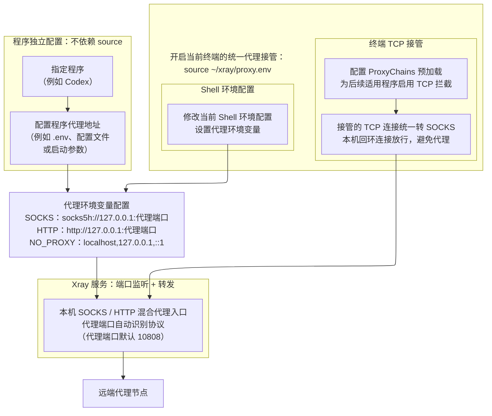

# Xray 本机代理

> **⚠️ Agent 操作警告：不要切断当前会话正在使用的代理**
>
> 执行 `stop`、`restart`、`switch`，或修改当前线路、端口之前，先确认当前 Agent 会话及其他任务是否通过本项目的 SOCKS 或 HTTP 入口联网。连接可能中断；**当前会话依赖该端口或无法确认时，不要在本会话中执行这些操作**。`status`、`test` 只能检查代理本身，不能证明当前会话没有使用它。

---

本项目由同一个 Xray 进程在 `127.0.0.1` 提供 SOCKS / HTTP 混合代理入口，同一端口自动识别协议，使用当前选定节点。项目自带 Linux x86_64 版 Xray 26.1.23。流量从当前节点发出，不配置分流；`ping` 不走此代理。

管理命令格式：

```text
bash ~/xray/xray.sh <命令>
```

`start` 启动代理，`boot` 设置开机自启，`terminal` 设置新终端是否自动使用代理。

## 1 基本配置

### 1.1 当前线路

当前线路写在 `config/active.txt`，可选 `vless`、`vmess`、`hysteria2`；同一时间只运行一条。文件缺失或为空时，启动默认使用并写入 `hysteria2`；非法线路名报错，不自动换线路。

### 1.2 节点链接

节点链接保存在 `config/links/` 下对应线路的文件中。当前线路的链接改完后，需执行 `restart` 才会生效；其他线路的链接在切换到该线路时生效。链接为空、解析失败或核心配置校验失败时，服务仍会监听本机端口，但拒绝转发外部连接。不存在的链接文件会在启动或切换时建成空文件，不会自动填入节点。

### 1.3 本机端口

统一代理端口写在 `config/port.txt`，填写一个 `1–65535` 的整数，默认 `10808`，SOCKS 和 HTTP 共用。启动或执行 `source` 时都会检查端口配置：文件缺失、为空或内容无效，就使用默认端口并写回文件。修改端口后，重启代理并重新 `source`；单独配置代理地址的程序也需更新端口。

## 2 代理架构

执行 `source ~/xray/proxy.env` 会配置当前 Shell 的代理环境变量，并通过 ProxyChains 为当前终端后续运行的程序启用 TCP 接管。这些设置作用于当前终端后续运行的命令及其子进程。

支持代理环境变量的程序可以独立配置代理，无需执行 `source`。



**注意：** 本机回环连接仍保持直连。且该方案不能保证覆盖所有程序或 UDP 流量。

## 3 命令

按需执行对应命令。通常先 `start` 启动服务，再用 `source` 让当前终端接入代理。

### 3.1 服务管理

| 命令 | 说明 |
|---|---|
| `bash ~/xray/xray.sh start` | 按当前线路在后台启动 SOCKS / HTTP 混合代理入口，并检查连接。服务已运行且入口与配置一致时不重复启动，也不重新加载线路或链接；入口不一致时提示检查。启动后保持后台运行。 |
| `bash ~/xray/xray.sh stop` | 停止服务，使用该代理的连接会断开。 |
| `bash ~/xray/xray.sh restart` | 停止服务，再按当前线路和配置启动，并检查连接。 |
| `bash ~/xray/xray.sh switch` | 选择线路，通过端口预检并停止旧服务后保存选择，再启动服务、检查连接。选择当前线路也会重启；新线路不可用时不会自动退回。 |

`stop`、`restart`、`switch` 会中断现有代理连接，执行前请看文首的 Agent 警告。

### 3.2 状态与连接检查

| 命令 | 说明 |
|---|---|
| `bash ~/xray/xray.sh status` | 查看线路、端口监听、进程 PID、开机自启和终端自动接入设置，不修改配置。 |
| `bash ~/xray/xray.sh test` | 分别测试 HTTP 和 SOCKS 代理，均访问 `https://www.google.com`，显示连接结果和首字节耗时；任一代理测试失败，命令返回失败。不改线路，也不启停监听。 |
| `bash ~/xray/xray.sh log` | 持续查看 `log/xray.log`，按 `Ctrl+C` 退出查看。 |

**端口监听不等于节点可用。**`start` 新启动服务，以及 `restart`、`switch` 后，都会执行与 `test` 相同的连接检查。请求正常完成且最终返回 HTTP 200 才算成功。Hysteria2、VLESS、VMess 使用同一测试标准。需要在脚本中用退出码判断联网是否成功时，使用 `test`；`start`、`restart`、`switch` 的联网检查失败不会自动停止已启动的服务，也不会因此返回失败。

首字节耗时表示响应延迟，不是节点 RTT 或下载速度。请求失败时显示“未测得”，详细原因写入日志。

### 3.3 当前终端接入

先启动 Xray，再在需要代理的 Bash 终端中执行：

| 命令 | 说明 |
|---|---|
| `source ~/xray/proxy.env` | 为当前终端设置代理环境并启用 ProxyChains；混合代理入口未就绪时会报错。 |
| `source ~/xray/proxy.env off` | 在启用代理的同一 Shell 中取消代理注入，恢复启用前保存的环境；不停止 Xray 服务。 |

`source` 不启动服务，`stop` 也不会清除已有终端的代理环境。重复 `source` 不会覆盖第一次保存的环境。

### 3.4 自动设置

| 命令 | 说明 |
|---|---|
| `bash ~/xray/xray.sh boot` | 选择开启或关闭开机自启，修改当前用户的 crontab，不影响当前服务。开机只启动一次，异常退出不会自动重启。 |
| `bash ~/xray/xray.sh terminal` | 选择开启或关闭新交互终端的自动接入，修改当前用户的 `.bashrc` 和项目内的启用标记；不影响已打开的终端，也不启停 Xray 服务。 |

`boot` 控制开机启动服务，`terminal` 控制新终端自动执行 `source`。若服务未启动，新终端的自动接入会报错；启动服务后，在该终端重新 `source` 即可。

## 4 项目文件与目录

下表的路径都位于 `~/xray/`。**一般只需要修改 `config/` 下的端口、当前线路和节点链接**；运行文件及自动生成的文件不要手改。

| 路径 | 是什么 | 是否手动修改 |
|---|---|---|
| `xray.sh` | 管理命令入口。 | 不改 |
| `scripts/xray-service.sh` | `start` 和开机任务调用的后台启动脚本。 | 不改 |
| `scripts/terminal-env.sh` | 管理脚本和终端代理共用的环境及端口处理函数。 | 不改 |
| `bin/xray_26.1.23` | Xray 核心程序。 | 不改 |
| `config/port.txt` | 本机 SOCKS / HTTP 统一代理端口。 | 需要换端口时改 |
| `config/active.txt` | 当前线路名：`vless`、`vmess` 或 `hysteria2`。 | 选线路时优先使用 `switch` |
| `config/links/vless.txt` | VLESS 节点链接，一行。 | 使用或更换 VLESS 时改 |
| `config/links/vmess.txt` | VMess 节点链接，一行。 | 使用或更换 VMess 时改 |
| `config/links/hysteria2.txt` | Hysteria2 节点链接，一行。 | 使用或更换 Hysteria2 时改 |
| `proxy.env`、`lib/libproxychains4.so` | 当前终端接入代理的脚本和库。 | 不改，按上节命令使用 |
| `runtime/` | 运行中的配置、锁文件及 `xray.pid`，可能含节点凭据；代理运行时需要它。 | 不改；迁移时不需复制旧内容 |
| `log/xray.log` | 运行日志；代理运行时持续写入。 | 用 `log` 查看 |
| `config/terminal.on` | 终端自动接入功能的持久标记文件。 | 不改；用 `terminal` 命令设置 |

## 5 节点链接格式与参数

本项目支持导入 Hysteria2、VLESS、VMess 三类节点链接。本章列出本项目链接解析器支持的格式、参数及组合限制，适用于随项目提供的 Xray 26.1.23；不代表支持 Xray 核心的全部协议或配置项。

### 5.1 链接格式

每个 `config/links/*.txt` 只放一条对应协议的完整节点链接，不支持订阅地址。域名、IPv4 和 `[IPv6]` 均可；特殊字符须 URL 编码，`#名称` 只作备注。

| 线路 | 支持的格式 |
|---|---|
| Hysteria2 | `hysteria2://密码@服务器:端口?参数`；支持 `用户名:密码` 认证和无认证节点，默认端口 443。端口可写成 `443,1000-2000` 这样的跳跃列表。 |
| VLESS | `vless://用户ID@服务器:端口?参数`，用户 ID 和端口必填。 |
| VMess | `vmess://Base64编码的JSON`（支持标准、URL-safe Base64 及省略末尾 `=`），或 `vmess://用户ID@服务器:端口?参数`。仅支持 AEAD，即 `aid` / `alterId` 必须为 0。 |

### 5.2 常用参数

#### 5.2.1 证书与 TLS

以下参数适用于 Hysteria2，以及使用 `security=tls` 的 VLESS / VMess。

| 参数 / 用途 | 支持范围 |
|---|---|
| `sni` / `serverName` / `peer` | TLS 服务器名称。 |
| `insecure` / `allowInsecure` / `allowinsecure` | 跳过常规证书验证：`1`、`0`、`true`、`false`，默认不跳过。 |
| `pinSHA256` / `pinnedPeerCertSha256` | 64 位十六进制 SHA-256 证书指纹，兼容带冒号格式；保留自签名 CA 证书的指纹校验，使用固定指纹时不强制 SNI 与证书域名相同。 |
| `ca` / `caFile` | 本机 CA 证书文件路径；相对路径以项目目录为起点。 |
| `alpn` | 逗号分隔；Hysteria2 仅接受 `h3`。WebSocket / HTTPUpgrade 的实际握手使用 HTTP/1.1；其他使用 uTLS 指纹的连接也受该指纹的 ALPN 设置约束。 |
| `fp` / `fingerprint` | 本项目解析器支持的指纹名，如 `chrome`、`firefox`、`safari`、`ios`、`android`、`edge`、`random`、`randomized`，以及解析器列出的 `hello...` 名称；`unsafe` 表示原生 TLS。Hysteria2、mKCP 不支持设置此参数，因为核心不会应用它。 |

#### 5.2.2 Hysteria2 混淆与端口

| 参数 / 用途 | 支持范围 |
|---|---|
| `obfs` | `salamander`；省略或 `none` 表示不混淆。 |
| `obfs-password` / `obfsPassword` | Salamander 混淆密码，启用混淆时必填。 |
| `mport` / `ports` | 跳跃端口，如 `443,1000-2000`；也可直接写在服务器地址的端口位置。 |
| `hopInterval` / `hop-interval` | 跳跃间隔，默认 30 秒、最小 5 秒；支持整数秒或 `10s`、`1m`、`1h`。 |

#### 5.2.3 VLESS / VMess 用户与传输

| 参数 / 用途 | 支持范围 |
|---|---|
| VLESS 用户设置 | `encryption`（默认 `none`，其他加密串由核心校验）、`flow`；当前核心的 Vision flow 仅支持直接 TCP + TLS / REALITY。 |
| VMess URI 用户设置 | `encryption` / `scy`：`auto`、`aes-128-gcm`、`chacha20-poly1305`、`none`、`zero`；`aid` / `alterId` 只能为 0。 |
| 传输方式 | `type` / `net`：`tcp`（`raw`）、`ws`（`websocket`）、`httpupgrade`、`grpc`、`xhttp`（`splithttp`）、`kcp`（`mkcp`）。 |
| 安全方式 | `security` / `tls`：`none`、`tls`、`reality`，默认 `none`。 |
| REALITY | `sni` / `serverName` / `peer`、`pbk` / `publicKey` / `password`、`sid` / `shortId`、`fp` / `fingerprint`、`spx` / `spiderX`、`pqv` / `mldsa65Verify`；公钥必填，仅用于 TCP、XHTTP、gRPC。 |
| WebSocket | `host`、`path`、`headers`（URL 编码的 JSON）、`ed`（early data 最大字节数）、`eh=Sec-WebSocket-Protocol`、`heartbeatPeriod`。 |
| HTTPUpgrade | `host`、`path`、`headers`、`ed`；此核心的 `ed` 非零表示启用提前发送，不使用 WebSocket 的 `eh` 机制。 |
| gRPC | `serviceName` / `path`、`authority`（默认取 `host`）、`mode`（`gun` / `multi`）、`multiMode`、`idle_timeout`、`health_check_timeout`、`permit_without_stream`、`initial_windows_size`、`user_agent`。 |
| XHTTP | `host`、`path`、`mode`（`auto` / `packet-up` / `stream-up` / `stream-one`）、`headers`、`extra`；使用 `extra` 时，`headers` 放在 `extra` 内，避免被覆盖。 |
| TCP | `headerType`（`none` / `http`）；`http` 模式支持 `host`、`path`，可用逗号分隔多个主机或路径。 |
| mKCP | `seed` / `path`、`headerType`（`none/srtp/utp/wechat-video/dtls/wireguard/dns`）、`domain`（仅 DNS 伪装）、`mtu`、`tti`、`uplinkCapacity`、`downlinkCapacity`、`readBufferSize`、`writeBufferSize`、`congestion`。 |

`headers` 是字符串键值 JSON，Host 请单独使用 `host`。WebSocket / HTTPUpgrade 也支持 `path` 中的 `?ed=...`，但不能再重复传入 `ed`。

### 5.3 兼容限制

以下格式或功能不支持：

- 当前核心没有的 Hysteria2 Gecko 混淆、Realm 模式，以及未列出的协议或客户端私有链接格式。
- 旧 VMess 非零 alterId，以及当前核心已移除的旧 HTTP/H2/QUIC 传输；不包括 Hysteria2 自身使用的 QUIC。
- 未接入的链接扩展参数、自定义 WebSocket early-data header、任意完整 Xray 配置导入。

未知参数、重复字段、别名冲突或不适用于当前传输的参数会报错。格式受支持、核心校验通过，不代表节点一定能联网；最终以 `start` / `test` 的联网结果为准。

HTTPUpgrade 限制：当前核心作为服务端时，非零 `ed` 提前发送的数据可能因接收缓冲处理缺陷而丢失，导致超时。参数可以导入，但该组合不能保证稳定；服务端使用此版本时，应省略 `ed` 或设为 `0`。

### 5.4 高级参数

<details>
<summary>展开参数表：ECH、TLS 选项、Hysteria2 带宽与 QUIC、XHTTP 扩展、VMess JSON、Socket</summary>

#### 5.4.1 ECH 与 TLS 选项

| 参数 / 用途 | 支持范围 |
|---|---|
| `ech` / `echConfigList` | Base64 ECHConfigList，自动补全 Base64 padding；VLESS / VMess 也支持核心的 ECH DNS 查询地址。Hysteria2 使用查询地址时须写 `echConfigList`。 |
| `echForceQuery` | `none`、`half`、`full`，需同时提供 ECH；默认 `full`，获取配置失败时不静默退回普通握手。 |
| `minVersion`、`maxVersion` | `1.0`、`1.1`、`1.2`、`1.3`；Hysteria2 必须允许 TLS 1.3。 |
| `enableSessionResumption` | 布尔值，控制 TLS 会话恢复。 |
| `disableSystemRoot` | 布尔值，控制是否禁用系统根证书。 |

VLESS / VMess 的非 mKCP 传输设置自定义 TLS 版本或会话恢复时，使用原生 TLS；不能同时指定 uTLS 指纹。

#### 5.4.2 Hysteria2 带宽与 QUIC

| 参数 / 用途 | 支持范围 |
|---|---|
| `up`、`down` | 核心的带单位速率字符串，如 `100 mbps`；不写单位时核心按 bit/s 解释。 |
| `upmbps` / `upMbps` / `up_mbps`，`downmbps` / `downMbps` / `down_mbps` | Mbps 数值，可含小数，按 1 Mbps = 1,000,000 bit/s 换算；不可与同方向的 `up` / `down` 重复指定。 |
| `congestion` | `reno`、`bbr`、`brutal`、`force-brutal`；强制 Brutal 必须设置有效的上行带宽。 |
| `initStreamReceiveWindow`、`maxStreamReceiveWindow`、`initConnectionReceiveWindow`、`maxConnectionReceiveWindow` | QUIC 接收窗口大小，由核心校验范围。 |
| `maxIdleTimeout`、`keepAlivePeriod` | 整数秒或带 `s/m/h` 单位的时间，由核心校验范围。 |
| `disablePathMTUDiscovery` | 布尔值。 |

#### 5.4.3 XHTTP extra

`extra` 是 URL 编码的 JSON 对象；未知字段、重复字段及会被覆盖的字段组合会报错。

| 参数 / 用途 | 支持范围 |
|---|---|
| 请求与填充 | `headers`、`xPaddingBytes`、`noGRPCHeader`、`noSSEHeader` |
| 上传控制 | `scMaxEachPostBytes`、`scMinPostsIntervalMs`、`scMaxBufferedPosts`、`scStreamUpServerSecs` |
| 连接复用 | `xmux`：`maxConcurrency`、`maxConnections`、`cMaxReuseTimes`、`hMaxRequestTimes`、`hMaxReusableSecs`、`hKeepAlivePeriod` |
| 独立下载 | `downloadSettings`：独立的 XHTTP 地址、端口、TLS / REALITY 及传输配置 |

#### 5.4.4 VMess Base64 JSON

| 参数 / 用途 | 支持范围 |
|---|---|
| 地址与身份 | `add`、`port`、`id` |
| 用户设置 | `aid`（只能为 0）、`scy`（加密方式） |
| 传输设置 | `net`、`type`、`host`、`path`；`type` 表示伪装类型，gRPC 中的 `gun/multi` 会转换为模式 |
| TLS 设置 | `tls`、`sni`、`alpn`、`fp`；Host 与 SNI 分别保留 |
| 版本与备注 | `v`、`ps`，不影响连接 |

VMess JSON 也接受正文中与所选传输匹配的标量参数。

#### 5.4.5 Socket 设置

三类线路均可使用 `sockopt`（URL 编码的核心 Socket 配置 JSON，检查字段名）传入 socket 设置；基于 TCP 的传输还可用 `tfo` / `tcpFastOpen`（不适用于 mKCP 和 Hysteria2）。参数能否生效还取决于操作系统、权限及传输类型。

</details>

## 6 迁移

依赖已具备时，项目运行和注册用户开机任务不需要 `sudo`。把本目录复制到目标机器的 `~/xray`。脚本按自己所在目录找配置，不依赖系统里的 `xray` 命令。当前自带核心和代理库是 **Linux x86_64** 文件；ARM 等其他架构需要对应核心，使用终端注入时还需对应架构及系统兼容的代理库。复制后执行：

```bash
chmod u+x ~/xray/xray.sh ~/xray/scripts/xray-service.sh ~/xray/bin/xray_26.1.23
```

启动和测试至少需要 `bash`、`python3`、`curl`、`ss`、`ip`、`awk`、`flock`、`ps`。开机自启另需 `crontab` 命令和正在运行的 `cron` 服务；没有它们仍可手动 `start`。`boot` 写入当前用户的 crontab，不需要 `sudo`。

节点链接文件及 `runtime/xray_config.json` 含连接凭据，只在自己的机器之间私下迁移。运行配置和 PID 无需作为迁移依据，脚本会按目标目录重新生成或核对；不要把节点链接粘贴进公开教程。

在新服务器上，至少填好 `config/active.txt` 指定线路的链接；其他线路的链接可稍后再填。确认 `config/port.txt` 后，先启动代理：

```bash
bash ~/xray/xray.sh start
```

确认 `start` 报告 HTTP、SOCKS 两种协议均连接正常后，再登记开机启动：

```bash
bash ~/xray/xray.sh boot
```

在 `boot` 的提示中选择开启。它只登记开机任务；当前代理由 `start` 启动，启动后保持后台运行。

若新打开的终端也要自动接入代理，再执行 `bash ~/xray/xray.sh terminal` 并选择开启。这一步设置该用户的 `~/.bashrc` 和项目内的启用标记，不启动代理。只让当前窗口接入代理时，执行 `source ~/xray/proxy.env`；关闭当前窗口的代理时，执行 `source ~/xray/proxy.env off`。

## 7 Codex 适配

### 7.1 安装与运行位置

复制 Xray 目录不会自动配置 Codex。**每换一台服务器**，先用笔记本 VS Code 的 Remote SSH 连接该服务器，再打开扩展列表，查看「SSH: 服务器名 - 已安装」中是否有 Codex：有就直接用，没有就点「安装到 SSH: 服务器名」。笔记本本地装过插件，不代表新服务器也装过；服务器侧插件装好后自带 Codex 程序，无须为 VS Code 侧栏另装 CLI。只有想在 SSH 终端直接输入 `codex` 时，才需要独立 CLI。然后在**运行 Codex 的服务器用户**下配置代理；命令环境隔离按需设置。

### 7.2 代理配置

安装插件或 CLI 后，`.env` 和 `config.toml` 不保证自动存在。在服务器终端执行 `mkdir -p ~/.codex`，然后用 VS Code 打开服务器上的 `~/.codex/`：文件不存在就新建，已存在就先备份、再修改原文件。如果设置过 `CODEX_HOME`，改用它指定的目录。下面代码块是**文件内容，不是要在终端执行的命令**。以下示例的 HTTP 和 SOCKS 共用 `10808`，须与 `config/port.txt` 一致；使用前确认 Xray 混合代理入口已经启动。

`~/.codex/.env`：若不存在，新建并写入以下八行；若已存在，将同名变量的值改为以下内容，缺少的变量再补上。每个变量只保留一条，其他原有内容保留。

```dotenv
HTTP_PROXY=http://127.0.0.1:10808
HTTPS_PROXY=http://127.0.0.1:10808
ALL_PROXY=socks5h://127.0.0.1:10808
http_proxy=http://127.0.0.1:10808
https_proxy=http://127.0.0.1:10808
all_proxy=socks5h://127.0.0.1:10808
NO_PROXY=127.0.0.1,localhost,::1
no_proxy=127.0.0.1,localhost,::1
```

Codex 程序读取这份文件，以代理访问 OpenAI，不需要依赖终端的 `source`。它不配置普通终端的网络。

### 7.3 命令环境隔离（可选）

若希望 Codex 自身使用代理，而它启动的命令不自动继承这些代理变量，再设置下面的 `~/.codex/config.toml`；需要代理的命令可显式 `source ~/xray/proxy.env`。若希望命令继承代理，则不添加这些排除规则。

`~/.codex/config.toml`：若不存在，新建并写入以下配置；若已存在，先备份并保留模型、项目信任、插件等原有设置。已有 `[shell_environment_policy]` 或 `[features]` 时，修改原来的同名段落，不要再添加一份；如果原段落已有其他环境过滤规则，先确认其作用，不要直接套用下面的示例；已有 `[shell_environment_policy.filters]` 时不要再叠加下面的 `exclude` 数组。

```toml
[shell_environment_policy]
inherit = "all"
exclude = [
  "HTTP_PROXY",
  "HTTPS_PROXY",
  "ALL_PROXY",
  "http_proxy",
  "https_proxy",
  "all_proxy",
  "NO_PROXY",
  "no_proxy",
]

[features]
shell_snapshot = false
```

这段配置从 Codex 执行命令的环境中排除上述八个代理变量（[官方环境策略说明](https://developers.openai.com/codex/config-advanced/#shell-environment-policy)），并关闭可能把它们重新带回的终端快照（关闭快照后命令启动可能稍慢）。其他代理机制（如 `LD_PRELOAD` 或程序自己的代理设置）不由这八个排除项控制。

保存配置后，重启 Codex 以加载新配置。若 Codex 被设置为断开 SSH 后继续运行，重连 SSH 不能代替重启。
